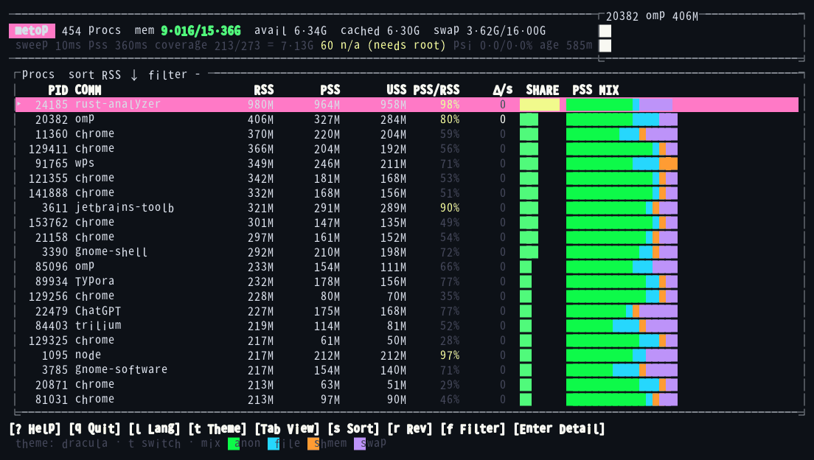
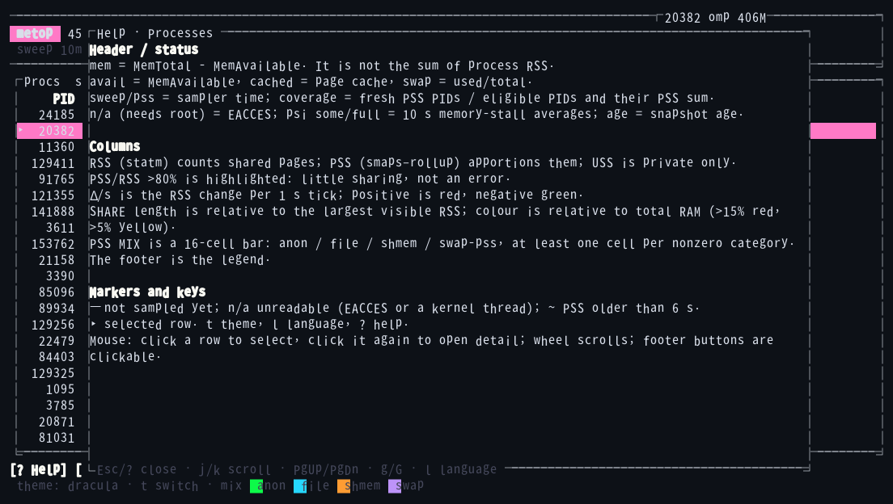
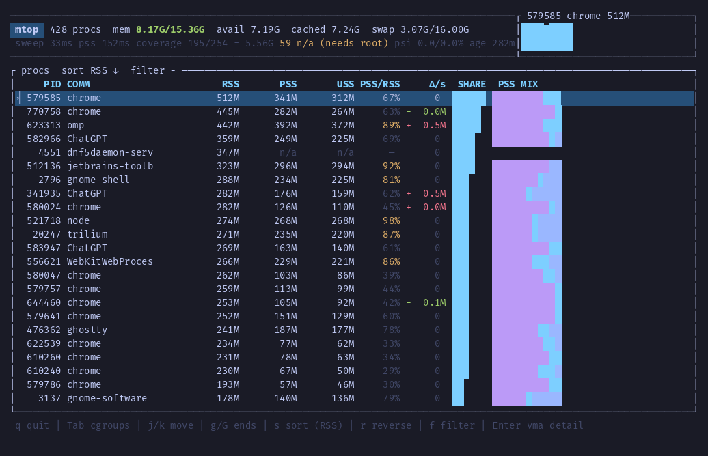
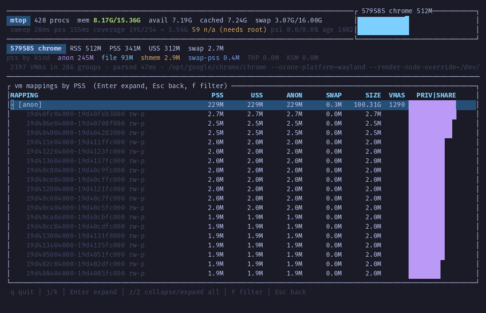
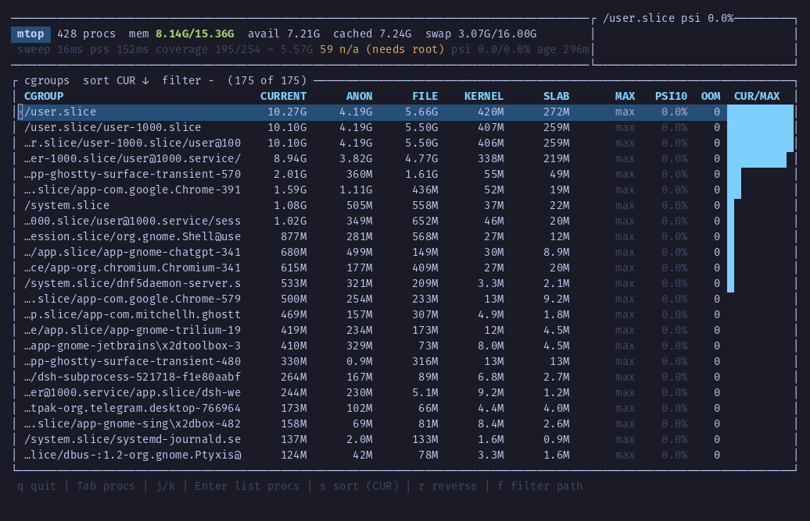
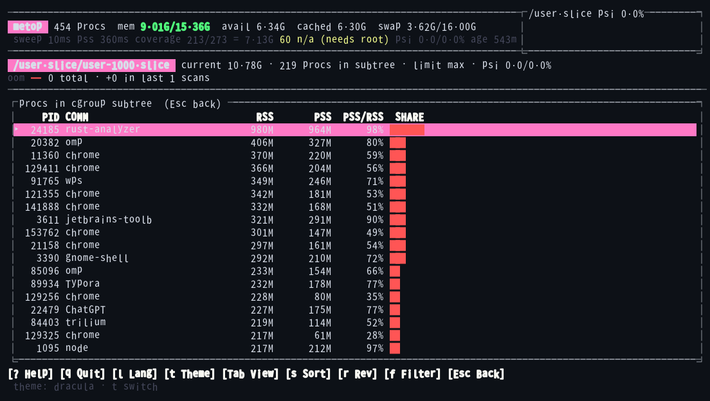
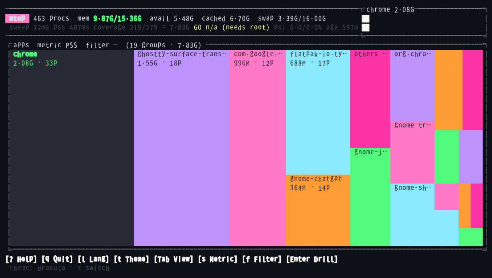

# metop

[](https://github.com/baka-world/metop/actions/workflows/ci.yml)
[](https://github.com/baka-world/metop/actions/workflows/release.yml)
[](LICENSE)
[](https://crates.io/crates/metop)
[](https://docs.rs/metop)

**English** · [简体中文](README.zh-CN.md)

A Linux memory analysis TUI. `htop` answers "how much RSS does each process have"; metop answers **"who is actually using the memory, and on what"** — with PSS/USS, per-mapping drill-down, cgroup accounting and an app-level treemap.



## Why PSS

RSS counts every shared page once per process, so any multi-process app looks inflated. Measured on one desktop at the same instant:

| | Chrome (25 processes) | Whole system (429 processes) |
|---|---|---|
| RSS summed | 4.1 GB | 11.9 GB |
| **PSS** | **1.7 GB** | **5.5 GB** |
| overcount | 2.4× | 2.2× |

RSS sums to roughly **2.2×** the real number system-wide (2.4× for Chrome). metop uses PSS for ranking and area, USS for "what would I free if I killed it", and shows the composition (anonymous / file / shmem / swap) so you can tell a heap leak from page cache.

## Features

- **Process view** — RSS / PSS / USS / PSS÷RSS / Δ·s⁻¹, share bars and a theme-coloured PSS-composition bar (legend in the process view).
- **VMA detail** — aggregate by mapping, then expand one mapping into its individual VMAs (address range, perms, PSS/USS/anon/swap/virtual size).
- **cgroup v2 view** — `memory.current` / `memory.stat` / `memory.max` / `memory.events`, PSI (`some`/`full`), OOM deltas, and drill-down into a subtree's processes.
- **App treemap** — processes grouped into applications (systemd `app-*.scope` → exe → comm), area ∝ PSS, long tail folded into `others`.
- **Shared trend window** — process, app, cgroup PSI and OOM histories use the same configurable time axis.
- **Scriptable** — `--json` (with `--fields` projection), `--diff` (with `--min-delta` / `--top`), stable pid ordering for diffing.
- **Mouse** — click a table row or treemap tile to select, click it again to open/expand/drill, wheel to scroll, and click the footer buttons (help, theme, language, view, sort, filter, enter, back, quit).
- **Bilingual help** — `?` opens page-specific help for processes, cgroups, apps, VMA detail and drill-down; `--lang auto|en|zh`, `METOP_LANG`, or `l` switches Chinese/English.
- **Themes** — seven palettes, including btop-derived `btop`, `dracula`, `gruvbox-dark` and `kanagawa-wave`; pick one with `--theme`, `METOP_THEME`, or `t` while running (no config file). Themes are authored in truecolor and auto-rendered to 256 or 16 colours when the terminal cannot display RGB; `--color` overrides detection.

## Install

Prebuilt packages are produced by GitHub Actions for `amd64` and `arm64`; every asset ships with a SHA256 checksum.

| Platform | Asset |
|---|---|
| Debian / Ubuntu | `metop_0.4.0-1_amd64.deb` · `metop_0.4.0-1_arm64.deb` |
| Fedora / RHEL / openSUSE | `metop-0.4.0-1.x86_64.rpm` · `metop-0.4.0-1.aarch64.rpm` |
| Any distro | `metop-v0.4.0-x86_64-unknown-linux-musl.tar.gz` · `…-aarch64-…` |

```sh
# Debian / Ubuntu
gh release download v0.4.0 --repo baka-world/metop --pattern '*.deb'
sudo dpkg -i metop_0.4.0-1_amd64.deb

# Fedora / RHEL
gh release download v0.4.0 --repo baka-world/metop --pattern '*.rpm'
sudo rpm -i metop-0.4.0-1.x86_64.rpm

# From crates.io (installs the `metop` binary)
cargo install metop

# From source
cargo build --release && sudo install -m755 target/release/metop /usr/local/bin/
```

Binaries are statically linked (musl), and the `.deb` has an empty `Depends:`.

## Usage

```
metop                       # whole system
metop --pid 1234            # start with a process selected
metop --theme dracula       # default | btop | dracula | gruvbox-dark |
                           # kanagawa-wave | light | ansi16 (or METOP_THEME)
metop --color 256           # auto | truecolor | 256 | 16
metop --lang zh             # auto | en | zh (or METOP_LANG / l)
metop --history 600         # trend window in seconds (1–3600; default 120)
metop --json --fields procs.pid,procs.rss_kb
metop --diff a.json b.json --min-delta 50M
```

| Key | Action |
|---|---|
| `Tab` | cycle views: processes → cgroups → apps |
| `j`/`k`, `↑`/`↓` | move one row |
| `Ctrl-d` / `Ctrl-u` | move down / up half a viewport |
| `Ctrl-f` / `Ctrl-b`, `PgDn` / `PgUp` | move down / up a full viewport |
| `g`/`G` | top / bottom |
| `s` / `r` | cycle sort key (apps: metric) / reverse |
| `t` | cycle colour theme (7 built-in palettes) |
| `?` | page help (header, columns, markers, keys) |
| `l` | switch UI language (English / 中文) |
| Mouse | click rows/tiles to select, click again to open or drill; wheel scrolls; footer buttons are clickable |
| `/` or `f` | filter (process name, pid, app name, cgroup path, mapping name) |
| `Ctrl-w` / `Ctrl-u` (filter input) | delete the previous word / clear the input |
| `Enter` | detail / expand mapping / drill into a cgroup or an app |
| `Esc` | clear filter, leave detail or drill-down |
| `q` | quit |

### Help and i18n



Press `?` for a page-specific explanation of the header, columns, colour codes, markers and keys. `--lang auto|en|zh`, `METOP_LANG` or `l` switch between English and Chinese; the footer buttons are clickable. Screenshots use the `dracula` theme.

### Process view



The header reports the sampler's own cost (`sweep`/`pss` ms, PSS coverage, sample age) so partial data is never presented as complete. Rows with `n/a` need privileges; a dimmed `~` marks a cached value older than the freshness window. The footer is a clickable command bar and the PSS mix legend only appears here.

### VMA detail



`Enter` on a process aggregates its mappings by name; `Enter` again expands one group into individual VMAs. `/` or `f` filters mapping names, `z`/`Z` collapse or expand everything.

### cgroup v2



Values are hierarchical: a parent already includes its children, so the list sorts by `current` instead of summing levels. `Enter` lists the processes in that subtree:



### Apps treemap



Area is PSS by default; `s` switches to USS (private only) or RSS (which overcounts shared pages, and says so in the title). Tiles use the active theme's bright palette, with dark labels; `Enter` drills into that app's processes.

All trend views use the same elapsed-time window (`--history`, 120 seconds by default). Process and app samples arrive roughly once a second; cgroup PSI and OOM use the slower cgroup scans. Empty graph columns mean no measurement, not zero. When multiple measurements share a column, the latest value is shown; OOM increments are summed.

## Scripting

```sh
metop --json > a.json                      # one snapshot, stable pid order
metop --json --fields help                 # paths available in this snapshot
metop --json --fields procs.pid,procs.rss_kb > small.json   # 194 KB -> 23 KB
metop --json --fields apps.name,apps.source,apps.pss_kb > apps.json
metop --json --pid $$ --fields detail.groups --vmas         # per-VMA detail
metop --diff a.json b.json --min-delta 50M --min-delta-metric max
```

The schema is `metop.snapshot.v2`; `schema` and `at_unix_ms` are always kept.
`--diff` still reads v1 and legacy `mtop.snapshot.v1` captures, so old files
remain comparable.

`procs[]` contains `pid`, `comm`, `exe`, `cmdline`, `start_unix_ms`, `cgroup`,
`rss_kb`, `delta_kb`, `denied`, `no_mm`, `pss_age_ms` and `pss`. `cgroup` and
`exe` are `null` when unreadable; `cmdline` is an argv array. A single
`--json` run has no previous sample, so `delta_kb` is `null`, not `0`; use
`--diff` (or compare two snapshots) for changes.

`procs[].rss_kb` comes from the cheap `statm` sweep; `pss.rss_kb` comes from a
later `smaps_rollup` walk. They are sampled at different instants and can
differ by a few pages (observed up to ~1.5 MB). Use `pss.rss_kb` inside a
PSS/rollup analysis, `procs[].rss_kb` for the ranking view, and do not treat
the two as one measurement. `pss_age_ms` describes the rollup sample only.

The `apps` array contains every application group without the treemap's
`others` folding. Each record has `name`, `source` (`scope`, `exe`, `comm`, or
`mixed`), `pss_kb`, `uss_kb`, `rss_kb`, `procs` and sorted `pids`; groups are
sorted by descending PSS, then name. PSS and USS sum only readable rollups and
can therefore be partial.

`detail` is serialized for `--json --pid PID`; `--no-detail` suppresses it, and
a projection such as `--fields procs.pid` skips the `smaps` walk entirely.
Repeat `--pid` or use `--pids 9671,9226` to request several VMA details in one
run: they are emitted as `details[]`, with failures in `detail_errors[]`, so
all samples share one `at_unix_ms`. The singular `detail` remains for one pid;
`--fields details` selects the array form.
`detail.groups[]` has `label`, `vsize_kb`, `rss_kb`, `pss_kb`, `uss_kb`,
`anon_kb`, `swap_kb` and `vma_count`. `vsize_kb` is virtual address space (the
kernel's `Size`), not resident memory; sparse mappings can be enormous.
`--vmas` adds `vma_list[]` with `start`, `end`, `perms`, `vsize_kb`, `rss_kb`,
`pss_kb`, `uss_kb`, `anon_kb` and `swap_kb` per VMA.

`--diff` prints ΔRSS / ΔPSS, current values and `new`/`gone` markers; the
snapshot writer itself is excluded via `self_pid`. `--min-delta-metric` selects
`rss`, `pss`, or `max` (default) for both the threshold and row ranking, so a
PSS-only change is not hidden by flat RSS.

## Requirements and permissions

- Linux with `/proc`; cgroup v2 optional (the view explains its absence).
- `/proc/PID/smaps_rollup` requires ptrace-read permission: a normal user only sees their own processes (and kernel threads have no address space at all). Run `sudo metop` for full coverage — verified at `264/264` covered, `denied=0`.
- The usage model is documented in [docs/REQUIREMENTS.md](docs/REQUIREMENTS.md); the root checklist is [docs/VERIFY-ROOT.md](docs/VERIFY-ROOT.md).

## Known issues

- **Counts are partial without privileges.** Non-root runs only cover your own user's processes; kernel threads never have a PSS and are excluded from coverage denominators.
- **Selection can move when sorted rows change.** Filter by PID with `/` or `f` to keep a process selected while its memory changes.
- **App grouping falls back to the executable.** Without a systemd `app-*.scope`, two Chromium installs merge into one tile; `others (N)` is synthetic and cannot be drilled into.
- **cgroup v1 is unsupported** — the view states why instead of showing zeros.
- **Sampling perturbs the target.** Reading `smaps` walks page tables under the mmap lock, so walks are budgeted (150 ms/tick) and the detail view is on-demand.

## TODO

- Optional: KSM / hugepage / pagemap metadata per VMA (via `wora-observability-linux-mm`).
- Optional: per-view metric defaults and a config file.

## Development

```sh
cargo build --release
cargo test --release
cargo clippy --all-targets -- -D warnings
cargo fmt --check
```

Changes start as an issue and follow the workflow in
[CONTRIBUTING.md](CONTRIBUTING.md): issue → triage → branch → verification →
PR → release. Use the issue forms for reproducible bug reports and scoped
feature requests.

## License

MIT — see [LICENSE](LICENSE).
