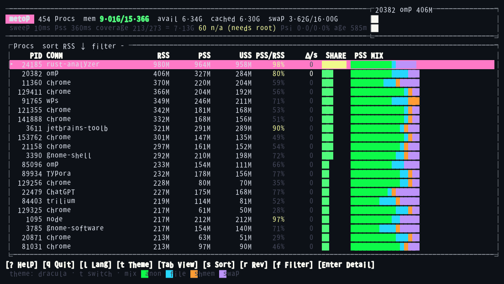
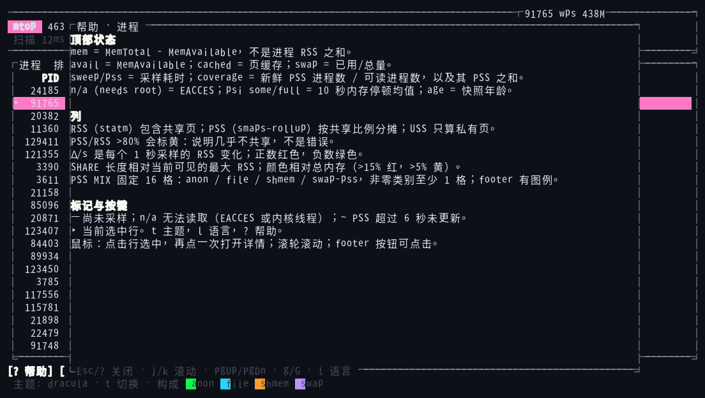
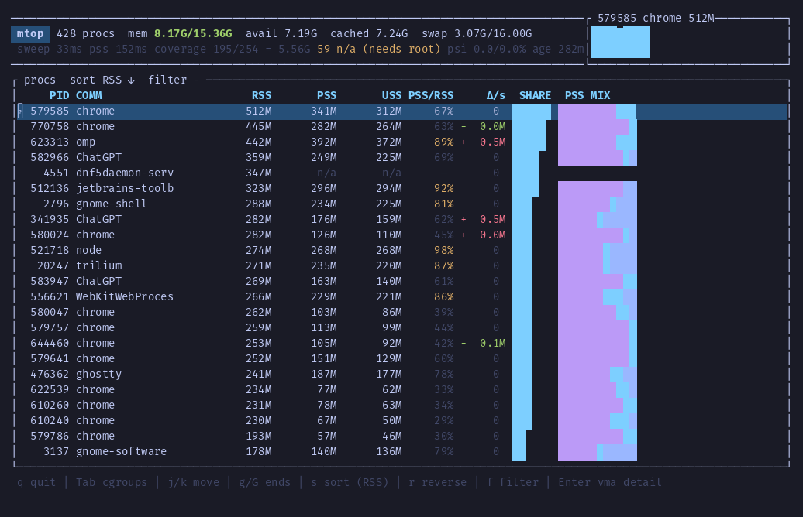
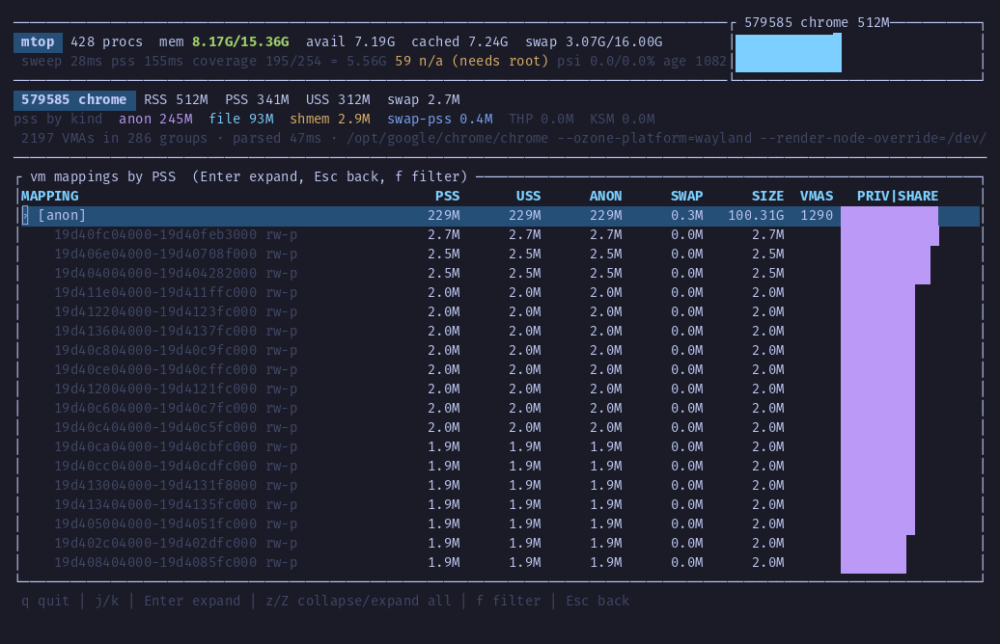
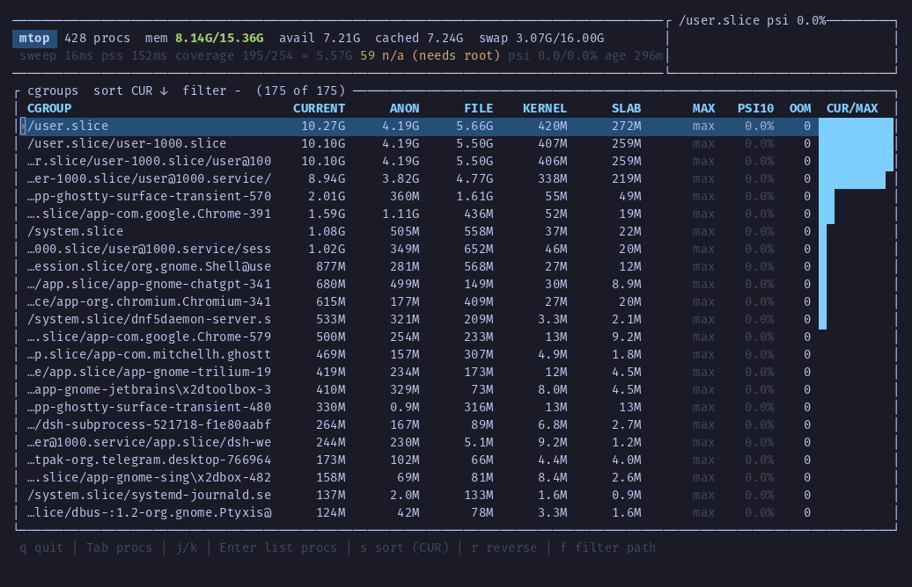
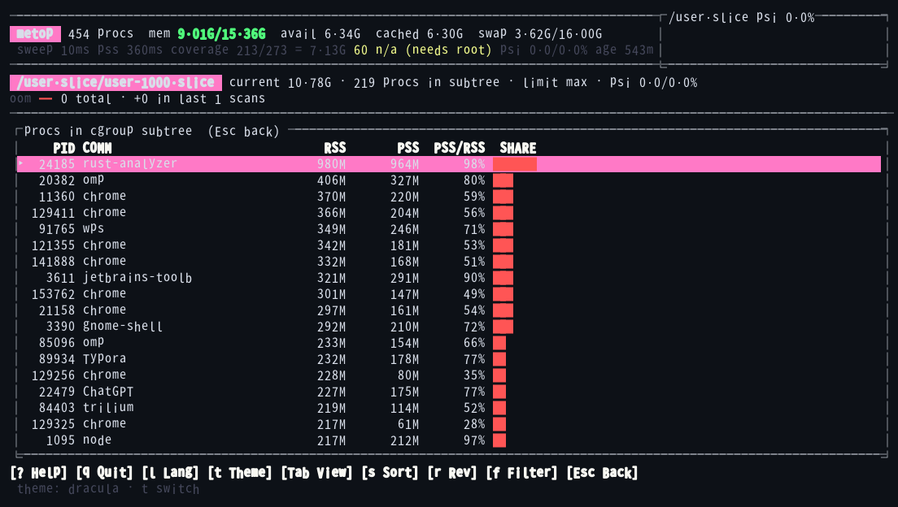
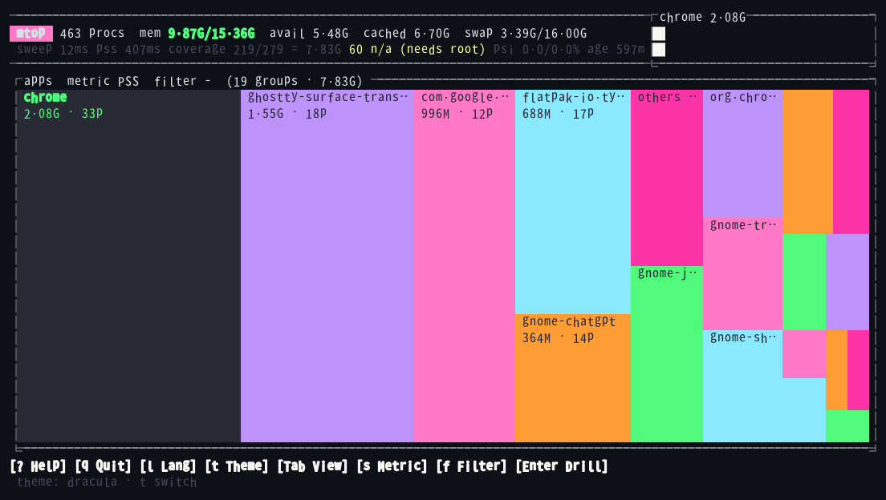

# metop

[](https://github.com/baka-world/metop/actions/workflows/ci.yml)
[](https://github.com/baka-world/metop/actions/workflows/release.yml)
[](LICENSE)
[](https://crates.io/crates/metop)
[](https://docs.rs/metop)

[English](README.md) · **简体中文**

Linux 内存分析 TUI。`htop` 回答"每个进程的 RSS 是多少"，metop 回答**"到底是谁占着内存、占在什么地方"**——用 PSS/USS 排序，能下钻到具体映射，也能按 cgroup 和应用聚合。



## 为什么是 PSS

RSS 会把每个共享页在每个进程里各算一遍，多进程应用因此被严重放大。同一时刻在一台桌面上的实测：

| | Chrome（25 个进程） | 全机（429 个进程） |
|---|---|---|
| RSS 相加 | 4.1 GB | 11.9 GB |
| **PSS** | **1.7 GB** | **5.5 GB** |
| 放大倍数 | 2.4× | 2.2× |

全机 RSS 之和大约是真实占用的 **2.2 倍**（Chrome 是 2.4 倍）。metop 用 PSS 排序和画面积，用 USS 回答"杀掉它能省多少"，并给出构成（anon / file / shmem / swap），用来区分堆泄漏和页缓存。

## 功能

- **进程视图**：RSS / PSS / USS / PSS÷RSS / Δ·s⁻¹，SHARE 条与主题色板的 PSS 构成条（图例仅在进程视图显示）。
- **VMA 详情**：按映射聚合，再展开成逐 VMA（地址区间、权限、PSS/USS/anon/swap/虚拟大小）。
- **cgroup v2 视图**：`memory.current` / `memory.stat` / `memory.max` / `memory.events`、PSI（`some`/`full`）、OOM 增量，并能下钻到子树里的进程。
- **apps treemap**：按应用聚合（systemd `app-*.scope` → exe → comm），面积 ∝ PSS，长尾折叠为 `others`。
- **统一趋势窗口**：进程、应用、cgroup PSI 和 OOM 历史共用可配置的时间轴。
- **可脚本化**：`--json`（`--fields` 点号投影）、`--diff`（`--min-delta` / `--top`），快照按 PID 稳定排序、可直接 diff。
- **鼠标**：点击表格行或 treemap 图块选中，再点一次打开/展开/下钻；滚轮滚动；footer 按钮（帮助、主题、语言、视图、排序、过滤、进入、返回、退出）均可点击。
- **中英文帮助**：`?` 打开当前页面的说明（进程、cgroup、应用、VMA 详情、下钻）；`--lang auto|en|zh`、`METOP_LANG` 或运行时 `l` 切换语言。
- **主题**：七套内置配色，其中 `btop` / `dracula` / `gruvbox-dark` / `kanagawa-wave` 的颜色取自 btop 自带主题；`--theme`、`METOP_THEME` 或运行时 `t` 切换（不需要配置文件）。主题以真彩色定义，终端不支持 RGB 时自动量化到 256 色或 16 色，可用 `--color` 覆盖检测。

## 安装

预编译包由 GitHub Actions 为 `amd64` 和 `arm64` 构建，每个产物都附 SHA256 校验和。

| 平台 | 产物 |
|---|---|
| Debian / Ubuntu | `metop_0.4.0-1_amd64.deb` · `metop_0.4.0-1_arm64.deb` |
| Fedora / RHEL / openSUSE | `metop-0.4.0-1.x86_64.rpm` · `metop-0.4.0-1.aarch64.rpm` |
| 任意发行版 | `metop-v0.4.0-x86_64-unknown-linux-musl.tar.gz` · `…-aarch64-…` |

```sh
# Debian / Ubuntu
gh release download v0.4.0 --repo baka-world/metop --pattern '*.deb'
sudo dpkg -i metop_0.4.0-1_amd64.deb

# Fedora / RHEL
gh release download v0.4.0 --repo baka-world/metop --pattern '*.rpm'
sudo rpm -i metop-0.4.0-1.x86_64.rpm

# 从 crates.io 安装（安装出的命令仍是 metop）
cargo install metop

# 从源码
cargo build --release && sudo install -m755 target/release/metop /usr/local/bin/
```

二进制是静态链接（musl），deb 的 `Depends:` 为空。

## 用法

```
metop                       # 全系统
metop --pid 1234            # 启动即选中某个进程
metop --theme dracula       # default | btop | dracula | gruvbox-dark |
                           # kanagawa-wave | light | ansi16（也可用 METOP_THEME）
metop --color 256           # auto | truecolor | 256 | 16
metop --lang zh             # auto | en | zh（也可用 METOP_LANG / l）
metop --history 600         # 趋势窗口秒数（1–3600，默认 120）
metop --json --fields procs.pid,procs.rss_kb
metop --diff a.json b.json --min-delta 50M
```

| 按键 | 作用 |
|---|---|
| `Tab` | 循环视图：进程 → cgroup → apps |
| `j`/`k`、`↑`/`↓` | 移动一行 |
| `Ctrl-d` / `Ctrl-u` | 向下 / 向上移动半屏 |
| `Ctrl-f` / `Ctrl-b`、`PgDn` / `PgUp` | 向下 / 向上移动整屏 |
| `g`/`G` | 顶部 / 底部 |
| `s` / `r` | 切换排序键（apps 视图切换面积指标）/ 反向 |
| `t` | 循环配色主题（7 套内置配色） |
| `?` | 当前页面帮助（顶部状态、列、标记、按键） |
| `l` | 切换界面语言（English / 中文） |
| 鼠标 | 点击行/图块选中，再点一次打开或下钻；滚轮滚动；footer 按钮可点击 |
| `/` 或 `f` | 过滤（进程名、PID、应用名、cgroup 路径、映射名） |
| `Ctrl-w` / `Ctrl-u`（过滤输入中） | 删除前一个词 / 清空输入 |
| `Enter` | 详情 / 展开映射 / 下钻 cgroup 或 app |
| `Esc` | 清除过滤、退出详情或下钻 |
| `q` | 退出 |

### 帮助与中英文



按 `?` 查看当前页面的顶部状态、列含义、颜色、标记和按键说明。`--lang auto|en|zh`、`METOP_LANG` 或运行时 `l` 切换中英文；footer 按钮均可点击。截图使用 `dracula` 主题。

### 进程视图



表头会报告采样器自身的开销（`sweep`/`pss` 毫秒、PSS 覆盖率、样本年龄），所以不会把部分数据伪装成完整数据。`n/a` 表示需要权限；带 `~` 的暗色值表示缓存已超过新鲜窗口。footer 是可点击命令栏，PSS 构成图例只在进程视图显示。

### VMA 详情



对进程按 `Enter` 按映射名聚合；再按一次 `Enter` 把一组展开成逐 VMA。`/` 或 `f` 过滤映射名，`z`/`Z` 全部收起/展开。

### cgroup v2



数值是层级累计的：父 cgroup 已包含子 cgroup，所以按 `current` 排序而不是跨层相加。`Enter` 列出该子树内的进程：



### apps treemap



面积默认是 PSS；`s` 切到 USS（只看私有）或 RSS（重复计算共享页，标题会明确写出）。图块使用当前主题的亮色配深色文字；`Enter` 下钻到该应用的进程。

所有趋势视图共用同一段经过时间（`--history`，默认 120 秒）。进程和应用约每秒采样一次；cgroup PSI 和 OOM 使用较慢的 cgroup 扫描。图中空列表示没有采样，不表示数值为零。同一列有多个采样时显示最新值；OOM 增量则求和。

## 脚本化

```sh
metop --json > a.json                                      # 一次快照，PID 稳定排序
metop --json --fields help                                 # 列出当前快照可用路径
metop --json --fields procs.pid,procs.rss_kb > small.json  # 194 KB -> 23 KB
metop --json --fields apps.name,apps.source,apps.pss_kb > apps.json
metop --json --pid $$ --fields detail.groups --vmas        # 逐 VMA 详情
metop --diff a.json b.json --min-delta 50M --min-delta-metric max
```

schema 为 `metop.snapshot.v2`；`schema` 和 `at_unix_ms` 始终保留。`--diff`
仍能读取 v1 和旧的 `mtop.snapshot.v1` 快照，历史文件可以继续比较。

`procs[]` 包含 `pid`、`comm`、`exe`、`cmdline`、`start_unix_ms`、`cgroup`、
`rss_kb`、`delta_kb`、`denied`、`no_mm`、`pss_age_ms` 和 `pss`。不可读时
`cgroup` / `exe` 为 `null`，`cmdline` 是 argv 数组。单次 `--json` 没有上一次
样本，所以 `delta_kb` 是 `null` 而不是 `0`；变化请用 `--diff` 或比较两份快照。

`procs[].rss_kb` 来自廉价的 `statm` sweep，`pss.rss_kb` 来自之后的
`smaps_rollup`；两者采样时点不同，可能差几个页（实测最大约 1.5 MB）。
PSS/rollup 分析用 `pss.rss_kb`，排序视图用 `procs[].rss_kb`，不要把两者当成
同一次测量；`pss_age_ms` 只描述后者。

`apps` 数组包含全部应用分组，不会像 treemap 那样折叠为 `others`。每组有
`name`、`source`（`scope` / `exe` / `comm` / `mixed`）、`pss_kb`、`uss_kb`、
`rss_kb`、`procs` 和已排序的 `pids`；分组按 PSS 降序、名称升序排列。PSS 和
USS 只汇总可读取的 rollup，可能是不完整值。

`--json --pid PID` 会附带 `detail`；`--no-detail` 可显式关闭，而
`--fields procs.pid` 这类投影会跳过 `smaps` 读取。重复 `--pid` 或用
`--pids 9671,9226` 可以在一次运行里请求多个 VMA 详情：结果放在 `details[]`，
失败项放在 `detail_errors[]`，共享同一个 `at_unix_ms`。单个 pid 仍使用
`detail`；`--fields details` 选择数组形式。`detail.groups[]` 有
`label`、`vsize_kb`、`rss_kb`、`pss_kb`、`uss_kb`、`anon_kb`、`swap_kb` 和
`vma_count`。`vsize_kb` 是虚拟地址空间（内核 `Size`），不是常驻内存；稀疏映射
可能非常大。`--vmas` 额外输出 `vma_list[]`，逐项包含 `start`、`end`、`perms`、
`vsize_kb`、`rss_kb`、`pss_kb`、`uss_kb`、`anon_kb` 和 `swap_kb`。

`--diff` 输出 ΔRSS / ΔPSS、当前值与 `new`/`gone` 标记；写快照的进程本身按
`self_pid` 排除。`--min-delta-metric` 可选 `rss`、`pss` 或 `max`（默认），同时
控制阈值和排序，因此 RSS 不变但 PSS 变化大的进程不会被隐藏。

## 环境与权限

- Linux + `/proc`；cgroup v2 可选（视图会说明缺失原因）。
- `/proc/PID/smaps_rollup` 需要 ptrace 读权限：普通用户只能看到自己用户的进程（内核线程没有地址空间）。`sudo metop` 才是全量——已实测 `264/264`、`denied=0`。
- 口径与设计细节见 [docs/REQUIREMENTS.md](docs/REQUIREMENTS.md)，root 验证清单见 [docs/VERIFY-ROOT.md](docs/VERIFY-ROOT.md)。

## 已知问题

- **没有权限时数据不全**：非 root 只覆盖本用户进程；内核线程永远没有 PSS，已从覆盖率分母中排除。
- **排序变化时选中进程可能改变**：用 `/` 或 `f` 按 PID 过滤，可在内存变化时固定观察目标。
- **应用分组会回退到可执行文件**：没有 systemd `app-*.scope` 时，两个 Chromium 安装会合并成一块；`others (N)` 是合成块，不可下钻。
- **不支持 cgroup v1**：视图会说明原因，而不是显示 0。
- **采样会扰动被测对象**：读 `smaps` 要在 mmap 锁下走页表，所以有 150 ms/tick 预算，详情按需读取。

## TODO

- 可选：逐 VMA 的 KSM / hugepage / pagemap 元数据（`wora-observability-linux-mm`）。
- 可选：按视图设置默认指标、配置文件。

## 开发

```sh
cargo build --release
cargo test --release
cargo clippy --all-targets -- -D warnings
cargo fmt --check
```

## 许可证

MIT，见 [LICENSE](LICENSE)。
